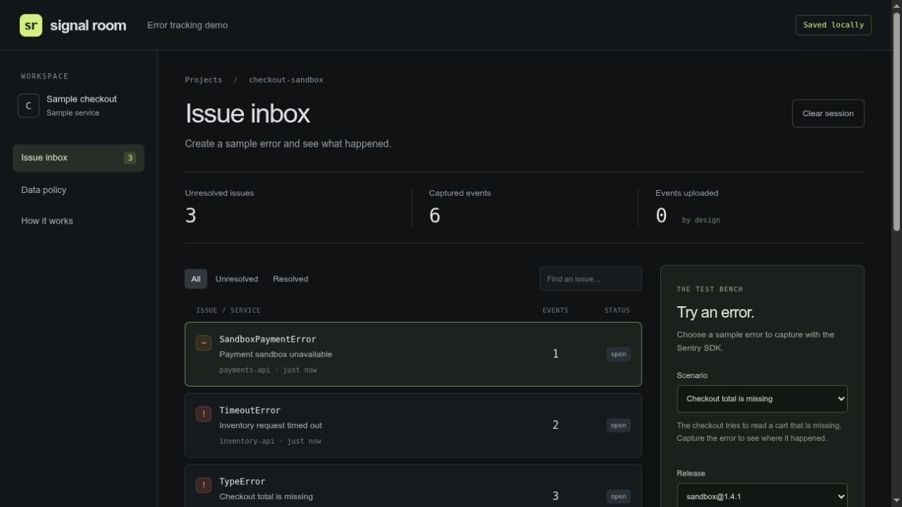

# Signal Room

A small app for trying error tracking with the official Sentry Node SDK. Create a sample error, look at its details, mark it resolved and trigger it again.

Everything stays in the app's memory. No errors are uploaded to Sentry, and you do not need a Sentry account. All services, releases and errors are made up.



*A sample error in the inbox, ready to inspect or mark resolved.*

## About this project

This demo makes the path from an error to an issue easy to follow. You can trigger the same error twice, inspect the saved details and see what happens when a resolved issue returns.

## Run it on your computer

You need Node 22.12+ and npm. No database or cloud account is needed.

From this project's folder, run:

```sh
npm ci --ignore-scripts
npm run check
npm start
```

Open [http://127.0.0.1:8130](http://127.0.0.1:8130). The app starts with six sample errors. Use the exact address printed in your terminal.

If port 8130 is busy, use `PORT=8131 npm start` and open the new address.

## Try it out

1. Choose **Checkout total is missing** and click **Capture this error**.
2. Select the issue to see the error details and the data the app kept. The code sketch helps explain the example; it is not a reconstructed copy of the source.
3. Click **Mark resolved**, then **Capture again**. The issue returns as **regressed**, meaning it happened again after being resolved.
4. Try the inventory timeout and payment error. These examples do not contact an inventory system or payment service.
5. Use search and status filters to find issues. Open **Data policy** to see what the app keeps, or **How it works** to follow the capture process.
6. Click **Clear session** to remove the current records. Restarting the app also clears them and loads fresh examples.

The app groups errors by their sample scenario. Any new error after resolution marks that issue as regressed, whichever sample release you choose. These are simple demo rules, not Sentry's own grouping rules.

## What this project shows

- Capturing real exceptions with the official Sentry SDK.
- Keeping only selected fields before storing an event.
- Sending events to local memory instead of a remote service.
- Building an issue inbox with search, filters and resolve/reopen actions.
- Checking requests and limiting how much data the app keeps.

This is an original SDK integration. Sentry's platform and SDK belong to their authors; this project is not affiliated with Sentry. It does not copy the Sentry server or provide its tracing, replay, alerting, teams or other platform features.

## Make changes

Run `npm run dev` to build the browser files and watch the server code. After changing browser code, run `npm run build` again and reload the page.

`.env.example` explains the basic host and port settings. The app does not load `.env` files automatically and does not need service credentials.

## Run the checks

```sh
npm run check
npm run format:check
npm audit
```

`npm run check` checks TypeScript, runs the tests and builds the app. The tests cover error capture, privacy rules, local storage and request handling. One test blocks network functions to check that capture makes no outside calls.

Read [what was checked](docs/VERIFICATION.md), [how the app works](docs/ARCHITECTURE.md) or the [review of the upstream Sentry repository](docs/UPSTREAM_REVIEW.md).

## Data and sharing

The app accepts only its three sample scenarios. Do not put real customer information or production errors into it. It keeps the latest 200 events and up to 20 examples per issue. Counts cover the current run of the app.

Everyone using the same running app shares one inbox. Clearing it clears it for everyone. There are no accounts or private workspaces. The request limiter briefly keeps IP addresses in memory; they are not added to events or app logs.

Sentry environment settings cannot turn on uploads. The SDK uses a local transport and a reserved example address. There is no live-upload option or browser tracking.

**The GitHub repository shares the code; it does not deploy a live website.** The default address works only on the computer running the app. Hosting requires an explicit `APP_ORIGIN`, suitable HTTPS/proxy setup and a review of access controls. See [security and hosting notes](SECURITY.md).

## Credits and license

The original app code uses the [MIT license](LICENSE). Sentry's Node/Core SDKs and other packages keep their own licenses; see [third-party credits](THIRD_PARTY_NOTICES.md) and `licenses/`.

No Sentry platform code, logos, screenshots, customer records, deployment settings or Git history were copied into this app. The platform's license is separate from the SDK's license.
