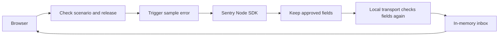

# How Signal Room works

Choose a sample error in the browser. The server triggers that error and passes it through the official Sentry SDK. The app keeps selected fields in memory and shows them in the inbox.

## Finding your way around

| File or folder | What it does |
|---|---|
| `scenarios.ts` | Defines the three sample errors |
| `telemetry.ts` | Creates a separate SDK client and captures each error in its own scope |
| `privacy.ts` | Rebuilds events using approved fields and normalizes file paths |
| `local-transport.ts` | Drops headers and non-event items, then checks fields again before storage |
| `store.ts` | Groups issues, counts events, limits stored examples and tracks status |
| `http.ts` | Checks requests, limits size/rate and serves only named static files |
| `src/client` | Displays the inbox, search, filters and error details |

The server files are in `src/server`.

## What comes from the SDK

The SDK captures exceptions, creates events and reads stack traces. This app supplies the local transport and inbox rules. It does not use Sentry's server-side grouping algorithm.

Errors from the same sample scenario share an issue. After you resolve it, any new event makes it regressed, even if you choose an earlier release.

The code sketch is there to explain the example. The SDK line number may refer to the built server file. There is no source-map service to map it back to original source.

## What is left out

There is no database, login, browser tracking, replay, cloud upload, tracing, alert service or background queue. The API accepts fixed sample choices, not arbitrary error data.

The app keeps 200 events and up to 20 examples per issue. Everyone shares the same memory, which is cleared when the app stops. Hosting needs a separate review of the proxy, HTTPS and access controls.
