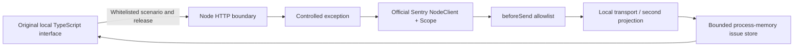

# Architecture

## Responsibilities

| Module | Responsibility |
|---|---|
| `scenarios.ts` | Three deterministic failures and fictional service labels |
| `telemetry.ts` | Dedicated official SDK client and capture scopes; no global uncaught handlers |
| `privacy.ts` | Event reconstruction and normalized local-retention projection |
| `local-transport.ts` | Drop non-event items and protocol headers; retain only safe projections |
| `store.ts` | Group by fixed scenario, counters, last-200/last-20 retention, resolution and recurrence |
| `http.ts` | Schema, Origin, Host, size/rate boundaries and explicit static-file map |
| `src/client` | Original responsive UI, local search, filters and readable payload inspection |

## SDK versus application behavior

The SDK performs exception capture, event creation and stack parsing. The custom transport consumes its envelope. **The SDK does not implement the grouping shown here.** This demo's store groups by fixed scenario IDs; it does not reproduce Sentry's server-side algorithms.

After an issue is resolved, a new event for the same scenario makes it regressed. This applies to the same, earlier or later listed release. That rule is explicit and intentionally simpler than a production monitoring workflow.

The UI's code sketch is explanatory. The normalized frame records the captured SDK line number, which can refer to bundled server code; no source maps or symbolication service are used.

## Intentional constraints

No database, live DSN configuration, upload toggle, browser SDK, replay, real user identifiers, authentication, organization model, worker queue, performance traces or remote alerting are included. The public API cannot ingest arbitrary telemetry. External hosting requires a separate review of deployment/proxy/access controls.
